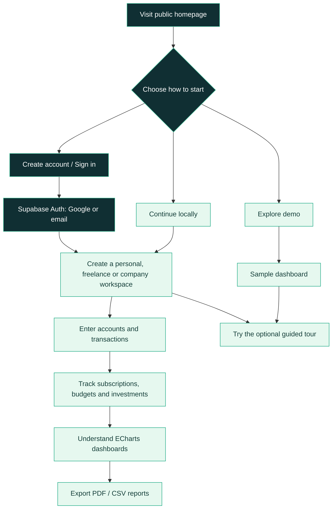
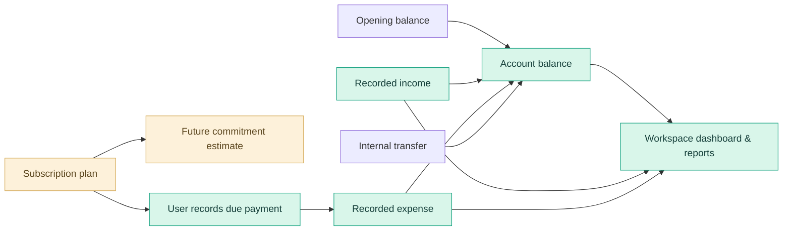
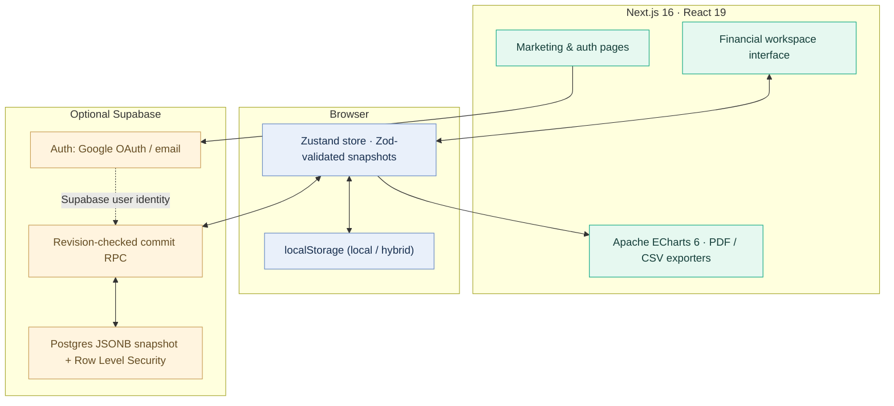
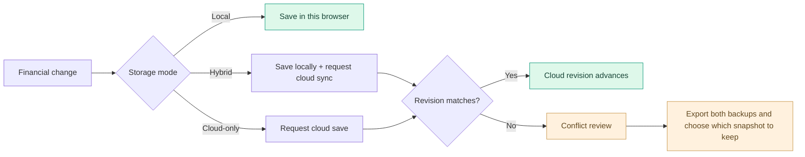

<div align="center">


<br/>

# Finora
### Your personal financial command center

**One place to track your money, manage recurring commitments, plan ahead, and understand the bigger picture.**

[**Live website →**](https://finora-nine-self.vercel.app/) · [**Try the demo →**](https://finora-nine-self.vercel.app/app?demo=1) · [**Read the user guide →**](docs/USER_GUIDE.md)

<br/>


</div>

> [!NOTE]
> Finora is a **manual financial organizer**, not a connected bank or audited accounting service. It supports **private browser-local usage**, plus optional Supabase-backed cloud or hybrid sync. All figures and prices are user-entered. The header is illustrative artwork, not a real account screenshot.

---

## ✨ At a glance

| One platform, different lives | Finora helps you… |
| :--- | :--- |
| 🧑 **Personal** | Track your salary, bills, savings accounts, budgets, and goals. |
| 🧑‍💻 **Independent / freelancer** | Separate client revenue, business costs, recurring tools, and tax *estimates*. |
| 🏢 **Company** | Organize accounts, expenses, cash flow, investments, and downloadable reports. |
| 🧭 **First-time users** | Learn the interface with a dismissible, replayable **11-step guided tour**. |

**Designed around clarity:** responsive layouts • light/dark themes • accessible custom selects and dialogs • interactive [Apache ECharts 6](https://echarts.apache.org/) visualizations • branded PDF statements.

### Explore the project

| Start here | Deep dive |
| --- | --- |
| [Getting started](#-quick-start) | [Full user guide](docs/USER_GUIDE.md) |
| [Feature tour](#-features) | [Architecture & data model](docs/ARCHITECTURE.md) |
| [Storage choices](#-choose-where-your-data-lives) | [Supabase & Vercel deployment](docs/DEPLOYMENT.md) |
| [Financial rules](#-how-finora-calculates) | [Security & limitations](#-security-privacy--scope) |

## 🧩 Features

| Area | What you can do | Important behavior |
| --- | --- | --- |
| **Overview** | See monthly income/expenses, an estimated net worth, cash-flow trends, spending categories and account/asset allocation. | Apache ECharts 6 powers the interactive charts. |
| **Transactions** | Record salary, freelance income, expenses and transfers; categorize, search and filter entries. | Transfers move funds between your accounts but **are not income**. |
| **Subscriptions** | Manage exact provider, plan, billing cycle, status, account, currency, renewal, auto-renewal info, URL and notes. | Upcoming costs are **forecasts** until a payment is recorded. |
| **Accounts** | Track cash, checking and savings with opening balances and account-to-account transfers. | Balances are calculated from manually entered entries. |
| **Planning** | Set category budgets, savings targets and debt records; enter repayments. | Repayments affect balances without being counted as ordinary expenses. |
| **Investments** | Track quantities, cost basis, manually updated prices and portfolio valuation. | **No live prices or brokerage integration.** |
| **Reports & bilan** | Filter a month, review summaries and export branded multipage PDF or transaction CSV. | Statements are not audited or official filings. |
| **Zakat** | Explore gold/silver nisab, estimated lunar hawl, eligible asset assumptions and reminders. | Metal prices/dates are manual and jurisprudence varies. |
| **Workspaces** | Keep personal, freelancer and company records separate; import/export JSON backups. | Each workspace owns its financial records. |
| **Storage & identity** | Use local, cloud or hybrid storage; sign in via Google or email; review sync conflicts. | Cloud requires a configured Supabase project. |

### 📊 Visual analytics

The dashboard includes interactive ECharts views for **cash flow**, **spending distribution**, and **asset allocation**, alongside budget and report summaries. Chart values come from the selected workspace—not from the decorative graphic above.

### 💳 Subscription intelligence

Track a real plan, not just a vague “monthly bill”:

| Field | Example |
| --- | --- |
| Service / provider | AI coding assistant / provider name |
| Exact plan | Pro subscription |
| Category | AI & coding tools |
| Price / billing currency | 20 USD (illustrative) |
| Billing period | Monthly |
| Workspace currency | MAD, with a **manually supplied** conversion rate |
| Renewal, status and payment account | Date, Active / Trial / Paused / Cancelled, chosen Finora account |
| Additional details | Auto-renewal information, provider URL and contract notes |

Projected monthly/annual commitments are **not ledger expenses**. Selecting **Record payment** on a due plan adds an expense and advances its next renewal date; it **does not charge your provider or bank**. Foreign-currency commitments use the conversion rate you enter, not a live FX quote.

### 📄 Premium exports

PDF exports use a branded, multi-page A4 layout with an executive summary, styled financial tables, category breakdown, closing balances, a transaction register, subscription commitments and pagination. Subscription forecasts are presented **separately from booked expenses**. CSV export contains individual transaction rows.

---

## 🧭 How it works

### From first visit to useful insights



> **New here?** Finora offers an optional 11-step tour with **Back**, **Next**, **Skip**, **Finish**, and a permanent **Help & tour** replay button. The tour navigates the interface without creating financial entries.

### The path of your money



**The distinction matters:** a recurring rule or subscription is a *plan*, while a transaction is a *recorded event*. Finora does not automatically create subscription payments or connect to payment providers.

---

## 🏗️ Architecture

Finora uses a **Next.js App Router frontend** with **Zustand** financial state. Browser-local data is available without a backend; Supabase adds optional authentication and user-scoped snapshot storage.



This diagram is conceptual: **accounts, transactions, subscriptions and workspaces live inside one finance snapshot**, not as individual database tables. Details: [Architecture & data model →](docs/ARCHITECTURE.md).

### Technology

| Layer | Technology |
| --- | --- |
| Frontend | Next.js 16 App Router, React 19, TypeScript strict mode |
| UI | Tailwind CSS 4, Manrope variable font, Lucide icons, custom accessible controls |
| Graphs | **Apache ECharts 6** with `echarts-for-react` |
| Finance state | Zustand 5 + browser persistence |
| Validation | Zod 4 |
| Documents | jsPDF 4 + CSV export |
| Optional authentication and cloud | Supabase Auth, PostgreSQL, RLS, revision-checked RPC |
| Testing & deployment | Vitest 3, GitHub Actions, Vercel |

---

## 🔐 Choose where your data lives

| Mode | Financial data in browser | Financial data in Supabase | Account needed | Key consideration |
| --- | --- | --- | --- | --- |
| **Local** | ✅ | ❌ | No | Clearing browser storage can remove records. |
| **Cloud-only** | No finance `localStorage` snapshot after switching | ✅ | Yes | Unsynced changes need a working connection. |
| **Hybrid** | ✅ | ✅ | Yes | Local data persists; sync conflicts require review. |

For cloud/hybrid, Finora stores user-owned JSON snapshots in `finance_workspaces`. Authenticated access uses Row Level Security; commits check the previously seen revision rather than silently overwriting a changed cloud version.



**No automatic field-by-field merging or end-to-end encryption is provided.** Hybrid mode retains data in the browser after sign-out. Back up sensitive finances regularly and avoid entering real financial information in shared or untrusted browsers.

See [Storage and recovery](docs/USER_GUIDE.md#saving-your-data) and [technical sync details](docs/ARCHITECTURE.md#storage-and-sync).

---

## 🚀 Quick start

**Requirements:** Node.js **22+** and npm. No Supabase project is required for local-only use.

```bash
git clone https://github.com/HAbdelhamid/Finora.git
cd Finora
npm install
npm run dev
```

Visit **http://localhost:3000**.

1. Visit the marketing homepage and choose **Get Started**, **Continue locally**, or **Explore sample dashboard**.
2. For a real local workspace, choose **Personal**, **Auto-entrepreneur**, or **Company** and give it a name.
3. Add an account, record an income or expense, then explore the dashboard and reports.
4. Open **Help & tour** if you'd like a step-by-step explanation.

Direct local/demo links: [/app?mode=local](https://finora-nine-self.vercel.app/app?mode=local) · [/app?demo=1](https://finora-nine-self.vercel.app/app?demo=1).

### Optional cloud configuration

Copy the environment template:

```bash
cp .env.example .env.local
```

Fill in **only public browser-safe values**:

```dotenv
NEXT_PUBLIC_SUPABASE_URL=https://YOUR-PROJECT.supabase.co
NEXT_PUBLIC_SUPABASE_ANON_KEY=YOUR_PUBLIC_ANON_OR_PUBLISHABLE_KEY
```

Then configure Supabase Auth providers, redirect URLs, the schema and revision migration. **Do not put Google client secrets or Supabase service-role keys in these variables.**

The SQL setup order matters:

1. `supabase/schema.sql`
2. `supabase/sync-migration.sql`

**Do not apply the migration blindly to an existing shared database:** it revokes direct finance-table write access in favor of the revision-checked RPC.

➡️ [Full authentication, database, OAuth and Vercel setup](docs/DEPLOYMENT.md)

### Development commands

```bash
npm run dev         # development server
npm run typecheck   # strict TypeScript
npm test            # Vitest
npm run lint        # ESLint
npm run build       # production compilation
```

The [GitHub Actions workflow](.github/workflows/ci.yml) runs type-checking, a React hook-order guard, unit tests and a production build on pull requests and `main` pushes.

---

## 🗂️ Project structure

```text
Finora/
├── app/
│   ├── page.tsx                 # Public landing page
│   ├── app/page.tsx             # Financial workspace
│   ├── login/ signup/           # Email and Google sign-in
│   ├── auth/callback/           # PKCE callback
│   └── reset-password/
├── components/
│   ├── overview.tsx             # Charts and headline metrics
│   ├── transactions.tsx         # Ledger and recurring rules
│   ├── subscriptions.tsx        # Detailed subscription plans
│   ├── accounts.tsx             # Cash, checking and savings
│   ├── planning.tsx             # Budgets, goals and debt
│   ├── investments.tsx          # Manual portfolio positions
│   ├── reports.tsx              # PDF and CSV export
│   ├── zakat.tsx                # Nisab and hawl planner
│   ├── workspaces.tsx           # Workspace and JSON backup tools
│   ├── storage-provider.tsx     # Local/cloud/hybrid orchestration
│   └── ui/                      # Selects, dialogs and toasts
├── lib/
│   ├── models.ts                # Domain types
│   ├── finance-store.ts         # Zustand + snapshot validation
│   ├── ledger.ts                # Balances, reporting and calculations
│   ├── subscriptions.ts         # Billing and renewal logic
│   ├── cloud-storage.ts         # Supabase snapshot RPC calls
│   └── premium-pdf.ts           # Statement layout and pagination
├── supabase/                     # RLS schema and RPC migration
├── tests/                        # Vitest suites
├── docs/                         # Detailed technical and user guides
└── .github/workflows/ci.yml
```

---

## 🧮 How Finora calculates

| Concept | Simplified principle |
| --- | --- |
| **Account balance** | Opening balance + recorded money in − recorded money out ± internal transfers |
| **Monthly net cash flow** | Recorded income − recorded expenses |
| **Net worth estimate** | Cash + savings + manually valued investments − debt owed + debt receivable |
| **Subscription commitment** | Monthly/yearly equivalent of active and trial subscriptions; optional **manual** currency conversion |
| **Investment value** | Units × manually entered current price |
| **Illustrative tax estimate** | User-entered rate × chosen annual base (revenue or nonnegative recorded profit) |
| **Illustrative Zakat** | Eligible net wealth × 2.5%, when assumptions meet the selected nisab; hawl approximate |

These are useful planning models, **not an authoritative tax engine, real-time market feed or religious ruling**. See [Calculation details](docs/ARCHITECTURE.md#financial-invariants).

---

## 🛡️ Security, privacy & scope

- **No bank connection** or payment initiation. Transactions and balances are manually entered.
- **Auth is optional** for local-only finance tracking; configured cloud modes require a Supabase user.
- **Cloud protection:** authenticated per-user Postgres RLS and a revision-aware write RPC.
- **Local records are not encrypted at rest**; cloud records are **not end-to-end encrypted**.
- **JSON backups may contain sensitive data.** Keep them somewhere private and secure.
- **Subscriptions** do not cancel a provider's plan or automatically bill an account.
- **Taxes and Zakat** are user-configured illustrations; they should be independently verified before decisions.
- **No multi-user workspace sharing**, automatic bank reconciliation, sourced FX rates or live stock feeds.

> [!WARNING]
> **Cloud-only saves depend on a successful sync.** If the connection fails, do not refresh or sign out with unsaved changes. Use a backup and resolve the sync error first. In any mode, export JSON regularly.

## 🛣️ Roadmap

Future ideas—not currently advertised as working features:

- [ ] Browser-level end-to-end tests and a formal security review
- [ ] Stronger per-record sync and automated cloud backups
- [ ] Bank statement import/reconciliation and receipt attachment
- [ ] Verified jurisdiction-specific tax logic with transparent versioning
- [ ] Server-side scheduled reminders and approved recurring posting
- [ ] Sourced FX rates and investment market data
- [ ] Additional accessibility refinements and export options

## 🤝 Contributing

Improvements, bug reports and accessible-design suggestions are welcome. Open an [issue](https://github.com/HAbdelhamid/Finora/issues) or propose a focused pull request. Run `npm run typecheck`, `npm test` and `npm run build` before submitting code.

## 📜 License

Released under the [MIT License](LICENSE).

---

<div align="center">

**Finora — clarity today, confidence tomorrow.**

[Launch Finora](https://finora-nine-self.vercel.app/) · [User guide](docs/USER_GUIDE.md) · [Architecture](docs/ARCHITECTURE.md) · [Deploy](docs/DEPLOYMENT.md)

</div>
