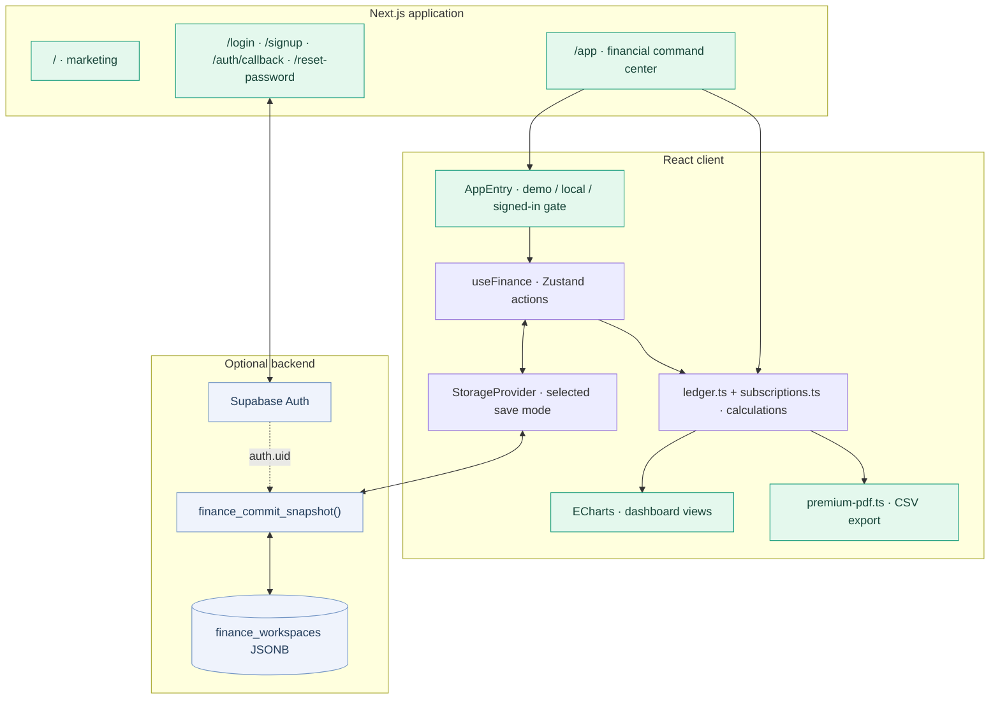
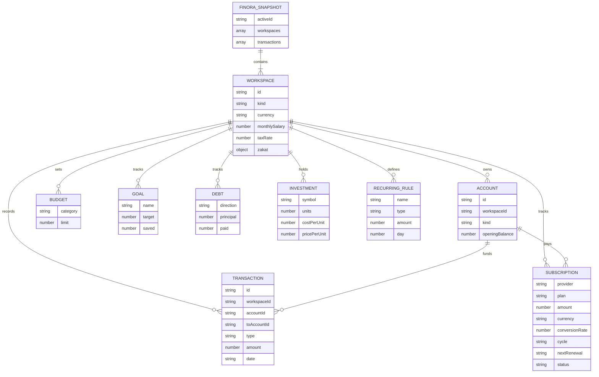
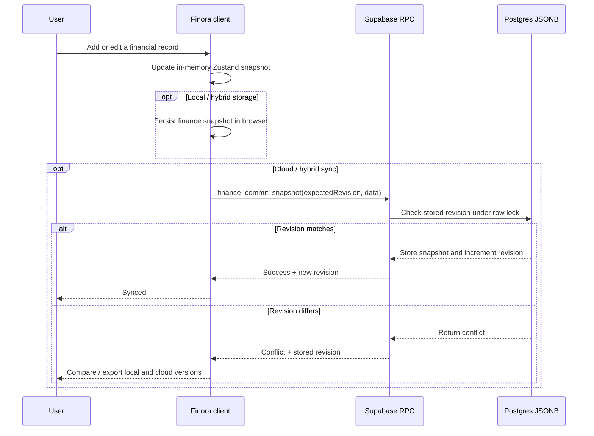
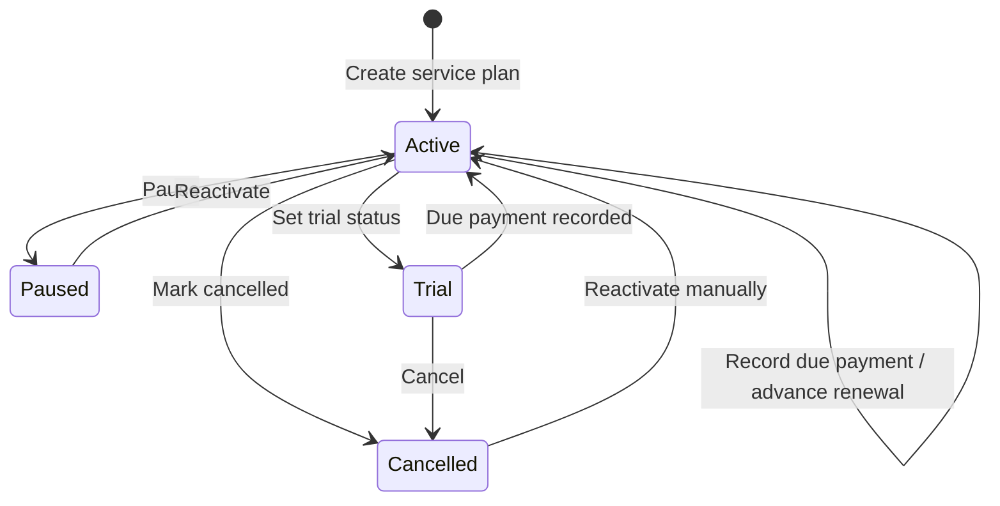

# Finora architecture & data model

> Engineering reference for Finora's **current implementation**. This is a client-side financial state model with optional Supabase snapshots, **not** a bank integration or accounting server. [← README](../README.md) · [User guide](USER_GUIDE.md) · [Deployment](DEPLOYMENT.md)

## 1. High-level design

| Responsibility | Implementation |
| --- | --- |
| Routing / marketing / authentication | Next.js 16 App Router and Supabase client auth |
| Financial UI | React 19 components and custom design system |
| Charts | Apache ECharts 6, wrapped by `echarts-for-react` |
| Domain calculations | Pure functions in `lib/ledger.ts`, `lib/subscriptions.ts` and `lib/finance-math.ts` |
| Financial state | Zustand in `lib/finance-store.ts` |
| Validation & backward compatibility | Zod-validated `FinoraData` snapshots |
| Browser persistence | Zustand persistence using `localStorage` (unless cloud-only) |
| Optional cloud persistence | Supabase Auth + Postgres JSONB + revision-checked RPC |
| Exports | Browser-side CSV and jsPDF A4 multi-page documents |
| Tests / delivery | Vitest, TypeScript, GitHub Actions and Vercel |

### Components and their boundaries



**Ownership:** the active workspace is a UI context. Financial records include a `workspaceId` and are filtered per workspace in `workspaceItems()`. The Supabase row is owned by a user; **multiple workspaces are stored together in one JSON snapshot per user**.

## 2. Logical financial data model

The following Mermaid ER diagram shows **TypeScript-level references**, not SQL tables. The database stores these collections together inside a single `data JSONB` field.



### Snapshot compatibility

`lib/finance-store.ts` uses a Zod `storedSchema` to parse imported, local and remotely retrieved data. Subscriptions were introduced after the initial snapshot structure; its schema defaults missing subscriptions to an empty array, allowing older valid backups to be loaded without discarding financial records.

Finora's Zustand persistence uses the `finora-v2` storage key. A JSON snapshot is not an audit log: restoring a backup replaces the snapshot by design.

## 3. Storage and sync

### Mode selection

- **Local:** Zustand persists finance snapshots to browser `localStorage`. Supabase is optional and not needed.
- **Hybrid:** browser finance snapshots remain; the app also syncs the full snapshot to Supabase after a short delay.
- **Cloud-only:** finance snapshots are not retained in the app's `localStorage` once the switch succeeds. Browser auth state is a separate concern.

Mode preference is retained in browser storage. Switching to cloud or hybrid loads the existing cloud snapshot or initializes one after the explicit opt-in.

### Supabase tables and policies

`supabase/schema.sql` defines `public.finance_workspaces`, keyed by `user_id` and protected with Row Level Security. `supabase/sync-migration.sql` adds a `revision BIGINT` field and a `finance_commit_snapshot(expected_revision, payload)` RPC.

After the migration, ordinary authenticated clients have **read permissions but not direct insert/update/delete** on the finance table. The RPC uses the authenticated `auth.uid()`, checks JSON shape and size, and compares the expected revision.

> [!IMPORTANT]
> This is a **whole-snapshot** concurrency mechanism. It protects against silently overwriting a newer server snapshot, but doesn't provide per-record merge or live collaboration.

### Revision flow



**Conflict resolution:** the user can export both full JSON snapshots and explicitly choose the cloud or local copy. Choosing the local version uses a revision-checked commit; if the revision changes again, Finora asks for another review.

**Failure behavior:** hybrid mode retains a local copy even if remote sync fails. Cloud-only mode cannot guarantee pending unsynced edits will survive refresh or session closure. The app attempts to warn about unsaved changes; do not rely on that warning as a backup.

## 4. Financial invariants

Core functions live in `lib/ledger.ts` and related calculation files.

### Account balances and transfers

For an account:

```text
balance = opening balance
        + income + incoming debt repayments
        - expenses - outgoing debt repayments
        + transfers in - transfers out
```

A **transfer** has a source and destination account and must not appear as new income or an ordinary expense in the cash-flow report.

### Recorded income, expenses and reports

```text
monthly recorded income  = sum(transactions of type "income" in month)
monthly recorded expense = sum(transactions of type "expense" in month)
monthly net flow         = income - expense
```

Debt principal movements use `debt_in` / `debt_out` and affect account balances rather than ordinary expense categories.

The month report derives categories, historical-through-month closing account balances, the transaction register and a configurable annual tax illustration. PDF and CSV are generated in the browser.

### Investments

```text
position market value = units × manually entered price per unit
portfolio market value = sum(position market values)
unrealized movement = portfolio value - portfolio cost
```

There is no automatic brokerage valuation, trading or live-market subscription.

### Subscriptions

Subscriptions are separate from both ordinary recurring rules and transaction records.



A subscription stores provider, plan, category, cost, original currency, manually supplied conversion rate, cycle, next renewal, status, payment account, auto-renew flag, URL and notes.

- A plan's commitment cost is a **projection**, not a bank debit.
- Forecasts include **active and trial** plans; paused/cancelled ones are excluded.
- `recordSubscriptionPayment` adds one expense transaction, using the subscription amount × manual exchange rate in the workspace currency.
- The due date moves forward according to the billing cycle; the app prevents a second payment posting for the same completed renewal.
- Finora neither automatically bills a provider nor cancels an external subscription.

### Taxes and Zakat

An illustrative tax estimate uses the user-entered rate on either annual revenue or `max(0, annual income − annual expense)`. It is **not** an official tax engine.

The Zakat planner uses manually entered prices/assets and either **85g gold** or **595g silver**, an estimated 354-day lunar hawl, and a 2.5% scenario calculation subject to the configured assumptions. Jurisprudence and exact dates vary.

## 5. UI and accessibility

- `components/widgets.tsx` includes shared chart cards, metrics and ECharts wrappers.
- `components/ui/finora-select.tsx` provides viewport-aware, searchable custom selects with keyboard support.
- `components/ui/finora-feedback.tsx` provides notifications, numeric dialogs and confirmation dialogs.
- `components/guided-tour.tsx` powers the 11-step guided tour, with browser-level dismissal state.
- Sidebar/mobile navigation appears in `app/app/page.tsx`.
- React uses a stable hook order across loading and ready states to avoid hydration/first-workspace crashes.

## 6. Quality and maintenance

Run the commands from the project root:

```bash
npm run typecheck
npm test
npm run lint
npm run build
```

The GitHub Actions [CI workflow](../.github/workflows/ci.yml) runs TypeScript, a targeted React rules-of-hooks guard, Vitest and a production build.

Current targeted tests cover financial arithmetic, storage behavior, forms, identity avatars, workspace onboarding, tour definitions, subscriptions, and PDF generation including pagination.

### Known limitations

- No encrypted browser snapshot storage or end-to-end encrypted cloud records.
- No immutable audit trail, normalized transaction SQL model or multi-user roles.
- No live exchange rates or investment prices.
- No formal banking aggregation, reconciliation or payment initiation.
- No automated record-level merge, scheduled backend notifications or guaranteed offline cloud-only save.
- No jurisdiction-certified tax computation or audited export.

> [!WARNING]
> Finora is a financial **organizer** and an MVP. Plan for external security review, backups, formalized audit rules and stronger integration testing before handling production-critical financial records.

---

[**← README**](../README.md) · [**User guide**](USER_GUIDE.md) · [**Deployment →**](DEPLOYMENT.md)
