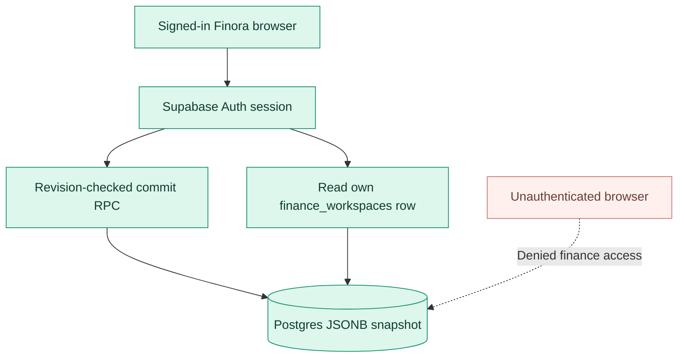

# Deploying Finora

**Supported path:** Next.js 16 frontend on Vercel, with an optional dedicated Supabase project for Google/email authentication and cloud/hybrid finance snapshots.

[← Main README](../README.md) · [Architecture](ARCHITECTURE.md) · [User guide](USER_GUIDE.md)

> [!IMPORTANT]
> **Local-only tracking needs no backend or API credentials.** Only configure Supabase if you need user accounts and cloud storage.

## Deployment checklist

- [ ] Node.js 22+ locally
- [ ] Install and run the project
- [ ] Create a dedicated Supabase project if cloud storage is needed
- [ ] Review/apply SQL schema and revision migration in order
- [ ] Configure Google and/or Email authentication providers
- [ ] Configure OAuth callback and password reset redirect URLs
- [ ] Set the public environment variables in Vercel
- [ ] Deploy from `main`
- [ ] Test authentication, onboarding, sync, backups and PDF output

## 1. Development environment

```bash
git clone https://github.com/HAbdelhamid/Finora.git
cd Finora
npm install
npm run dev
```

Open http://localhost:3000. Continue locally or enter demo mode even if Supabase is unconfigured.

For validation:

```bash
npm run typecheck
npm test
npm run lint
npm run build
```

Project scripts are defined in [package.json](../package.json). The GitHub workflow installs dependencies, validates TypeScript and React hook order, runs unit tests and builds on pull requests / pushes to `main`.

## 2. Create a Supabase project (optional)

For the cloud/hybrid modes, use a **dedicated project** so Finora's permissions changes don't interfere with unrelated clients.

In **Supabase → SQL Editor**, inspect and run these scripts in order:

1. [`supabase/schema.sql`](../supabase/schema.sql) — creates `public.finance_workspaces` and establishes per-user Row Level Security policies.
2. [`supabase/sync-migration.sql`](../supabase/sync-migration.sql) — adds the `revision` column, revokes direct finance table mutations for clients and creates `public.finance_commit_snapshot(expected_revision, payload)`.

The data model uses **one JSONB finance snapshot per Supabase user**, not a new SQL table for each account/transaction/subscription.

### Permissions model



The RPC derives the user from `auth.uid()`, validates payload shape/size, checks the expected revision and returns a conflict on a mismatch.

> [!WARNING]
> The migration **revokes direct finance-table INSERT/UPDATE/DELETE** privileges from authenticated clients. Review existing consumers before applying it to a shared or preexisting database. Finora expects the RPC after migration.

## 3. Configure authentication providers

Finora supports **Google OAuth through Supabase Auth** and **Supabase email/password**.

### Google

1. In Google Cloud Console, create a suitable OAuth 2.0 web application/client.
2. In **Supabase → Authentication → Providers → Google**, explicitly **enable** Google and enter the Google OAuth Client ID and Client Secret **there**.
3. Add the Supabase callback in Google's authorized redirect URI list:

   `https://YOUR-PROJECT.supabase.co/auth/v1/callback`

4. Save the provider settings. Merely creating credentials in Google Cloud **does not enable Google in Supabase**.

### Email and password

1. Enable Email under **Supabase → Authentication → Providers → Email**.
2. Configure confirmation preferences and test the email verification process.
3. Before a public launch, configure appropriate production SMTP, templates and sender verification. Default mail limits may not suit production workloads.
4. Verify password reset flow end to end.

### Allowed redirects

In **Supabase → Authentication → URL Configuration**, set your deployment's site URL and allowed redirect URLs.

| Use case | Example redirect |
| --- | --- |
| Production site URL | `https://finora-nine-self.vercel.app` |
| Production OAuth/email callback | `https://finora-nine-self.vercel.app/auth/callback` |
| Production recovery | `https://finora-nine-self.vercel.app/auth/callback?flow=recovery` |
| Local OAuth/email callback | `http://localhost:3000/auth/callback` |
| Local recovery | `http://localhost:3000/auth/callback?flow=recovery` |

Use **your own domain** if you deploy a fork. Preview domains must be explicitly allowed if you intend to exercise OAuth there. Restrict the allow list to origins you actually control.

The app exchanges the OAuth PKCE code in `/auth/callback` and uses a verified recovery session before changing a password at `/reset-password`.

## 4. Configure public frontend variables

Locally, create a `.env.local` based on [`.env.example`](../.env.example):

```dotenv
NEXT_PUBLIC_SUPABASE_URL=https://YOUR-PROJECT.supabase.co
NEXT_PUBLIC_SUPABASE_ANON_KEY=YOUR_PUBLIC_ANON_OR_PUBLISHABLE_KEY
```

Only the **public browser-safe** Supabase URL and publishable/anon key belong here.

Never commit or expose:
- Supabase `service_role` keys
- Google OAuth client secrets
- Passwords, access tokens, refresh tokens, or backup contents
- Complete user financial exports

If you don't need cloud storage, leave the two variables unconfigured and use local/demo modes.

## 5. Deploy on Vercel

1. Import [the repository](https://github.com/HAbdelhamid/Finora) into Vercel as a **Next.js** project.
2. Select the `main` branch for production.
3. In **Project → Settings → Environment Variables**, add the two `NEXT_PUBLIC_*` values for the environments you need.
4. Redeploy after changing variables or Supabase provider settings that influence runtime behavior.
5. Confirm the production domain and Supabase redirect allow list correspond exactly.

Finora's public live example is [finora-nine-self.vercel.app](https://finora-nine-self.vercel.app/), but your fork should use its **own** domain and Supabase credentials.

## 6. Validate the running app

Test these flows using a test account and **non-sensitive fictional data**:

| Check | Expected outcome |
| --- | --- |
| Visit `/` | Marketing homepage appears. |
| Open `/app` signed out | Entry choices for authentication, local or demo appear. |
| Use `/app?demo=1` | Clearly labeled sample dashboard. |
| Use `/app?mode=local` | Ability to create a local workspace without authentication. |
| Sign in with Google | Redirects through Supabase callback to the app. |
| Sign in with email | Authenticated session works after any required confirmation. |
| Create first workspace | An empty workspace opens without a browser crash. |
| Add a transaction | Dashboard/account balances recalculate. |
| Add subscription | Commitment forecast updates, but expenses do not increase. |
| Record due subscription payment | One expense posts; renewal advances. |
| Export PDF and CSV | Files download and include correct user-entered values. |
| Switch to Hybrid | Sync health reaches “Saved and in sync.” |
| Simulate two different saved snapshots | Conflict dialog offers backups and explicit choice. |
| Reset a password | Recovery URL leads to a verified password-update session. |
| Sign out | Returns to public site without deleting an intentional local copy. |

### Vercel runtime and GitHub CI

- GitHub Actions: [Quality checks](https://github.com/HAbdelhamid/Finora/actions/workflows/ci.yml)
- Vercel: check Build Logs, Functions/Runtime Logs and deployment state.
- A successful deployment build does **not** prove that every Google authentication or browser storage journey works. Test them on actual devices.

## 7. Storage operations and disaster recovery

### Browser-local

Finora persists finance data to `localStorage` on the current browser. Clearing site data, browsing privately, or losing access to the browser can remove that copy.

### Cloud-only

The browser does not retain a financial `localStorage` snapshot after the mode switch succeeds. Network failures can leave changes unsynced; **never** treat an unsynced tab as a durable backup.

### Hybrid

Both local and cloud copies are maintained. Finora syncs after a short delay and supports manual retry.

### Conflicts

Finora checks whole-snapshot revisions. When cloud and browser data differ, users can download **both** snapshots as JSON and explicitly choose one. There is no automatic per-record merge.

**Operational advice:**
- Export JSON backups regularly to a secured location.
- Do not email sensitive backup files unprotected.
- Avoid arbitrary database resets or manual edits in live data.
- Test restores with fictional data before relying on the workflow.
- Enable operational database backups separately according to your Supabase plan and security requirements.
- Rotate compromised credentials at their source; public frontend keys are not secrets, but privileged tokens are.

## 8. Known operational limits

- A working Supabase OAuth provider is required for Google sign-in; Vercel environment variables alone are not enough.
- Local records are not encrypted at rest, and cloud storage is not end-to-end encrypted.
- No bank feeds, automated payment execution, sourced FX rates or live asset prices.
- No scheduled backend notification worker, audit log or collaborative workspace authorization.
- Tax and Zakat calculations are illustrations using user assumptions, not official determinations.
- The current sync unit is a full finance snapshot; larger-scale financial usage calls for stronger integration tests, security review and data governance.

---

[**← README**](../README.md) · [**Architecture**](ARCHITECTURE.md) · [**User guide**](USER_GUIDE.md)
