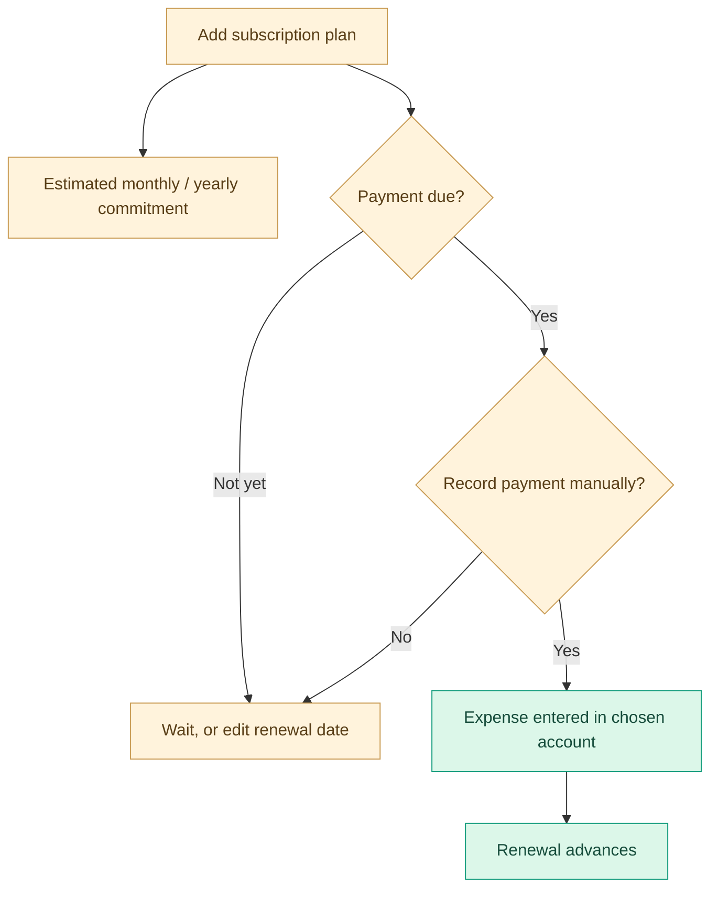

# Finora user guide

> **Audience:** first-time users, personal finance trackers, freelancers and small teams using separate company *workspaces*. [← Back to README](../README.md) · [Launch Finora](https://finora-nine-self.vercel.app/)

Finora is a manual financial organizer. It does **not** connect to your bank, move money, charge subscription providers, retrieve investment prices or file taxes.

## Contents

1. [Getting started](#getting-started)
2. [The interface](#the-interface)
3. [Setting up your accounts](#setting-up-your-accounts)
4. [Recording income and expenses](#recording-income-and-expenses)
5. [Transfers and recurring rules](#transfers-and-recurring-rules)
6. [Detailed subscriptions](#detailed-subscriptions)
7. [Budgets savings goals and debt](#budgets-savings-goals-and-debt)
8. [Investments and financial overview](#investments-and-financial-overview)
9. [Reports PDF and CSV](#reports-pdf-and-csv)
10. [Tax estimates and Zakat](#tax-estimates-and-zakat)
11. [Saving your data](#saving-your-data)
12. [Troubleshooting and FAQs](#troubleshooting-and-faqs)

## Getting started

### 1. Choose your entry point

| Action | When to use it |
| --- | --- |
| **Create account / Sign in** | You want to authenticate using Google or email and optionally keep finance data in Supabase. |
| **Continue locally** | You want private browser-only tracking without registering. |
| **Explore sample dashboard** | You want to learn with fictional transactions and workspaces. |

Open [the marketing homepage](https://finora-nine-self.vercel.app/) to begin. Direct links: `/app?mode=local` and `/app?demo=1`.

> [!IMPORTANT]
> The **Demo** contains invented finances. Use a **new non-demo workspace** for real records. A signed-in account alone does not automatically mean cloud storage is enabled—open **Storage** to check your selected mode.

### 2. Set up a workspace

Choose **Personal**, **Auto-entrepreneur / freelancer**, or **Company**, then enter a workspace name. New workspaces start with an empty financial history and a main account with an opening balance of zero.

Use **Workspaces** to add more independent contexts—for example, personal finances separate from freelance billing. Currency and country are workspace settings; subscription billing can additionally use a different manually converted currency.

### 3. Try the guided tour

At first entry Finora may offer **Show me around**. This 11-step guide explains workspaces, dashboard, income/expenses, accounts, planning, investments, reports, Zakat and storage.

You can select **Next**, **Back**, **Skip tour**, **Finish**, or close it with **Escape**. The bottom-corner **Help & tour** button restarts it. The guide never creates or deletes your financial entries.

## The interface

On desktop, the sidebar groups pages into **Workspace**, **Insights** and **Manage**. On mobile, open it using the hamburger button.

| Page | Purpose |
| --- | --- |
| Overview | Headline metrics and charts |
| Transactions | Ledger, categories, transfers and recurring-rule shortcuts |
| Subscriptions | Detailed plans, renewal forecasts and manually recorded payments |
| Planning | Budgets, savings goals and debts |
| Accounts | Account balances and transfers |
| Investments | Manually valued portfolio holdings |
| Reports | Monthly statement, PDF and CSV |
| Zakat | User-configured Zakat scenario |
| Workspaces | Workspace settings and JSON backup / restore |
| Storage | Local, cloud and hybrid settings, sync health and account details |

The top bar shows the current storage mode, a light/dark theme switch and—when signed in—an account menu and quick **Sign out** control.

## Setting up your accounts

Open **Accounts** and create one record for each balance you want to track:

- **Checking**: a bank/current account you enter manually.
- **Cash**: physical money you want to track.
- **Savings**: an account designated for savings.

Enter the account's opening balance as of the time you are starting your records. You can then add transactions rather than repeatedly editing the starting amount.

**Example:** If your checking account begins with 5,000 MAD, a 2,000 MAD recorded salary increases its calculated balance to 7,000 MAD; a 150 MAD expense reduces it to 6,850 MAD. These values are examples, not data from a live account.

Avoid entering the *same* investment value in both your cash account and investment holdings if you want a useful net-worth estimate.

## Recording income and expenses

Open **Transactions → New transaction**. Choose a transaction type, enter a positive amount, a date, an account, a category (where applicable), and an optional description.

| Transaction | Example | Included in ordinary income / expense totals? |
| --- | --- | --- |
| Income | Salary or freelance invoice paid | **Yes — income** |
| Expense | Groceries or utilities | **Yes — expenses** |
| Transfer | Checking → Savings | **No** |
| Debt repayment | Recorded from the Planning screen | Changes the account and debt record, but **not ordinary spending categories** |

Use the **Activity ledger** to search, filter and delete entries. Finora uses an in-app confirmation before destructive operations.

**Important:** Enter salary only once. A configured monthly salary target or recurring rule does not automatically create a transaction.

## Transfers and recurring rules

### Transfers

A transfer has a source account and a **different** destination account. It subtracts from one and adds to the other, without manufacturing new income.

### Recurring rules

The **Recurring revenue and bills** section creates shortcuts for regular items such as rent or salary. They are **manually posted** with **Post now**. If the same recurring description was already posted that month, Finora asks for confirmation before creating another entry.

Recurring rules are basic reusable shortcuts. For plans that need provider, contract, currency, renewal and service details, use **Subscriptions** instead.

## Detailed subscriptions

Open **Subscriptions → Add subscription** and describe the service precisely.

| Detail | Why it matters |
| --- | --- |
| Service and provider | Distinguishes home broadband, your mobile operator, a code assistant or a SaaS account |
| Exact plan | Identifies the actual tier rather than a generic charge |
| Category | Phone, internet, AI/coding, software, streaming, cloud, insurance or other |
| Amount and currency | Stores the **actual per-cycle price** |
| Conversion rate | Optional manually entered rate if plan currency differs from the workspace |
| Cycle | Weekly, monthly, quarterly or yearly |
| Next renewal date | Date on which the next bill is expected |
| Payment account | The Finora account to use when recording the payment |
| Status | Active, Trial, Paused or Cancelled |
| Auto renewal | Informational setting; not a service cancellation switch |
| URL and notes | Provider page, contract terms, included features or cancellation notes |

### Forecasts vs actual payments

Merely adding a subscription does **not** post an expense. When a bill is due, **Record payment** asks for confirmation; the application records an expense **in the workspace currency** using the manual conversion rate and advances the renewal. It does **not** send money or communicate with the provider.

Monthly/annual commitment figures include active and trial plans; paused and cancelled plans are excluded. For multi-currency accuracy, keep exchange rates up to date yourself.

## Budgets savings goals and debt

### Budgets

Open **Planning** to set monthly category limits. A budget represents your spending plan; it does not create a bill or block real purchases. Compare it with manually recorded expenses.

### Savings goals

Add a target and update the **amount saved** manually. The goal tracker represents progress; recording progress does not transfer money between your accounts.

### Debt

Finora supports amounts **you owe** and amounts **owed to you**. Create a debt record with principal and choose an account when recording a repayment. The repayment updates the debt and posts an appropriate cash movement—not an ordinary category expense.

## Investments and financial overview

The **Investments** page stores positions with an asset type, units, cost per unit and manually entered current price. Valuations and unrealized changes use these numbers; Finora does not trade assets or stream prices from brokers.

On **Overview**, interpret the metrics carefully:

- Income/expenses reflect **recorded** transactions for the selected month.
- Cash flow shows historical monthly values using Apache ECharts 6.
- Spending distribution groups recorded expenses by category.
- Net worth is a planning estimate combining tracked accounts, valued investments and debts.

All workspaces are independent. Switch to another workspace in the sidebar to see its own records.

## Reports PDF and CSV

Open **Reports** and select a reporting month.

**Export PDF** creates a branded A4 statement with financial summary blocks, colored tables, expense categories, account balances, transaction details, a subscription commitment summary and page numbers. Long registers can span multiple pages.

**Download CSV** exports the month's individual transactions for spreadsheet review.

> [!NOTE]
> The PDF is a record of data you entered. It is **not an audited financial statement or an official tax filing**. Subscription commitments are displayed as **future planned expenses**, separately from booked spending.

## Tax estimates and Zakat

### Illustrative tax scenario

Under **Workspaces**, the entered rate and calculation basis control the illustration in **Reports**. The basis may be **gross recorded revenue** or **positive recorded profit** for the year.

This is not an official Moroccan IR, IS, TVA or auto-entrepreneur tax calculation. A rate of zero means **not configured**, not that no taxes are due.

### Zakat planner

Open **Zakat** and enter your selected reference (**gold or silver**), manually checked metal price per gram, relevant asset amounts, immediate liabilities and an estimated hawl start date.

Finora illustrates nisab using **85 g gold** or **595 g silver**, calculates potential Zakat at **2.5%** under its configured assumptions, and uses **approximately 354 days** to estimate a lunar year. Actual jurisprudential treatment and nisab conventions can vary.

Browser notifications depend on permissions and being in a compatible browser; there is **no always-on backend scheduler**. Confirm your dates and figures with a qualified religious authority where appropriate.

## Saving your data

Open **Storage** to choose a mode.

| Mode | What it does | Main risk |
| --- | --- | --- |
| Local | Saves your financial snapshot in this browser's `localStorage`. | Clearing site data or private browsing may lose it. |
| Cloud | Uses your signed-in Supabase account to save a user-scoped snapshot. | Unsaved changes may be lost if connectivity fails. |
| Hybrid | Saves to browser plus cloud, with revision-checked syncing. | Two devices can have conflicting versions requiring review. |

### Back up regularly

Use **Workspaces → Export backup** to download JSON. Keep the file somewhere private. The backup can contain sensitive financial information.

**Restore backup** replaces the current financial snapshot only after a confirmation; export your current data before restoring.

### Conflicts

If Finora detects distinct browser and cloud versions, it offers to download both JSON backups, then choose **which entire snapshot to keep**. There is no per-transaction auto-merge.

> [!WARNING]
> Never reset, clear browser storage, or switch away from cloud-only while a critical change is unsynced. Wait for **Saved and in sync** or export a backup first.

## Troubleshooting and FAQs

<strong>Why do I see the entry screen instead of the marketing homepage?</strong>

You're on `/app`. Visit `/` for the public marketing page. An unsigned browser opening `/app` can show account, local or demo choices.

<strong>Google sign-in says the provider is unavailable.</strong>

The administrator must enable **Google** in Supabase Authentication → Providers, configure the Google OAuth credentials in Supabase, and allow the correct callback URL. More: [Deployment guide](DEPLOYMENT.md).

<strong>Why is a subscription not appearing as an expense?</strong>

Subscriptions describe future commitments. Use **Record payment** when due to create an expense, or enter a separate transaction manually. Avoid recording the same payment twice.

<strong>Why does my cloud data look different on two devices?</strong>

Finora compares full-snapshot revisions and asks which copy to keep when necessary; it does not combine records automatically. Download both backups before choosing.

<strong>Is my data encrypted or automatically backed up?</strong>

Browser records aren't encrypted at rest, and the cloud isn't end-to-end encrypted. Do not assume automated scheduled backups. Export your own backups regularly.

<strong>Can Finora automatically pay subscriptions or import bank transactions?</strong>

No. Both require external integrations not present in this project.

---

[**← Main README**](../README.md) · [**System architecture →**](ARCHITECTURE.md) · [**Cloud deployment →**](DEPLOYMENT.md)
